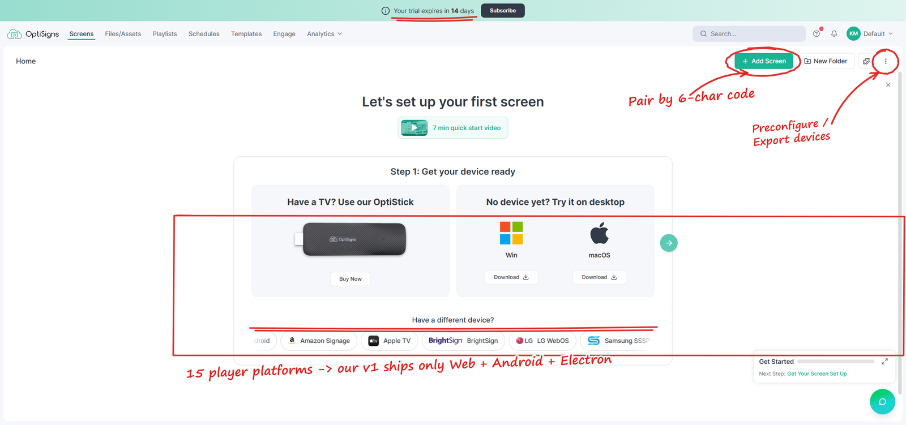
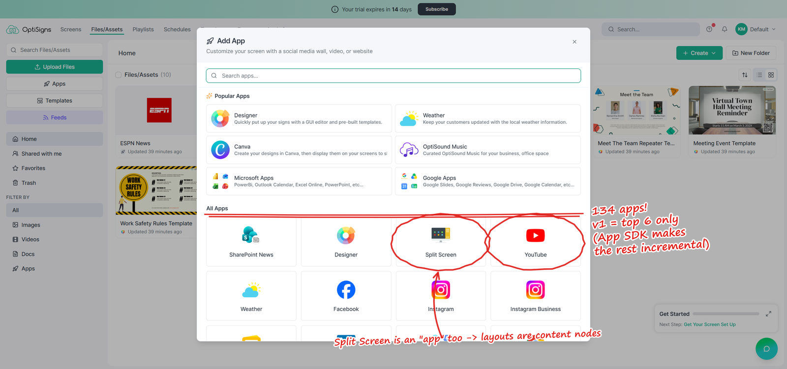
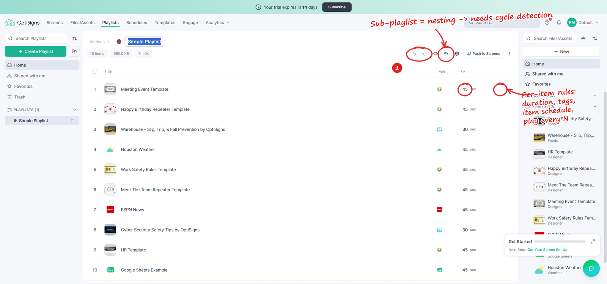
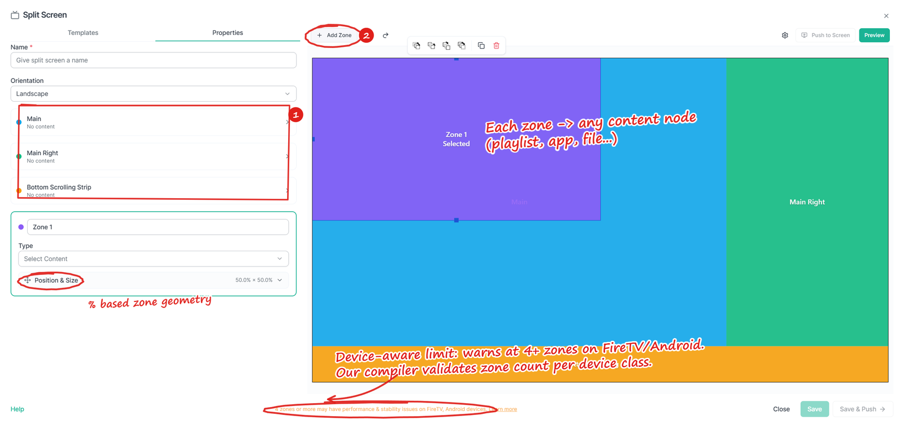
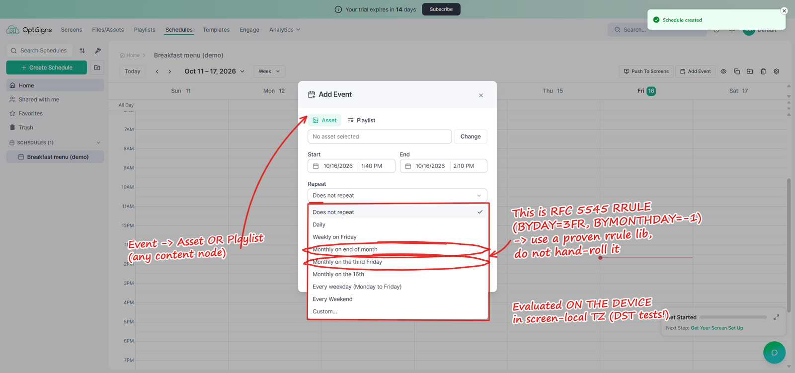
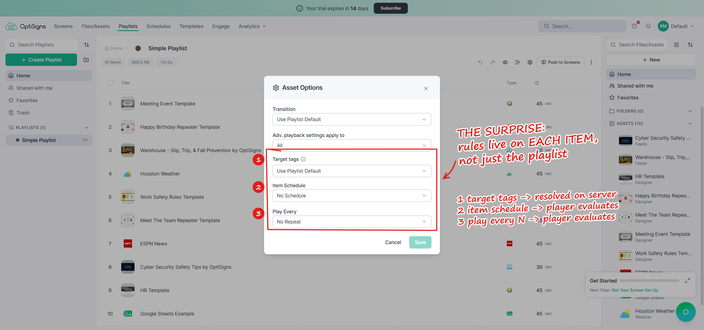
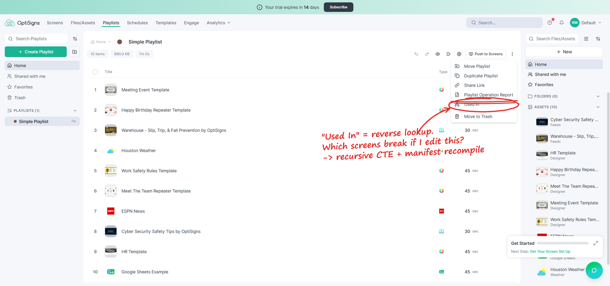
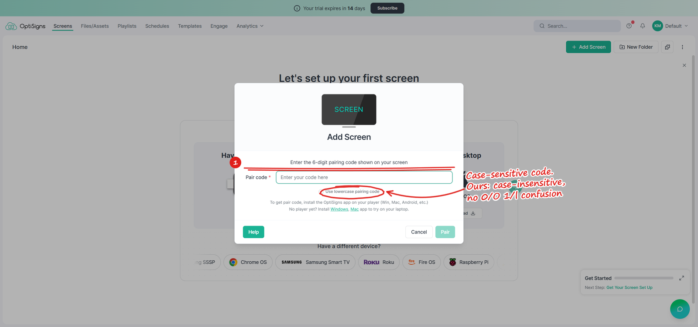

# SCIO Clone - Build Plan

## TL;DR

- **Goal:** a web portal + a player that lets a small business pair a TV, upload content, build playlists and layouts, schedule them, and keep playing when the internet drops.
- **Team:** 4 engineers (tech lead, backend/infra, frontend, player). Part-time designer, QA from week 10.
- **Timeline:** 16 weeks to a paid beta, in 5 phases. Each phase ends with a demo on a real TV.
- **Main bet:** the player is the product. A bug in the portal is annoying; a black screen in a shop loses a customer. So the player comes first.

---

## 1. What I saw using SCIO

I opened a trial account and used it like a new customer. These are the parts that matter for the plan (red marks are my notes).

**Screens.** You pair a TV with a 6-character code. There are players for 15 platforms, plus bulk tools like "Preconfigure Devices" and "Export Devices List".



**Assets & Apps.** Besides images and videos there are **134 apps** (YouTube, Weather, Power BI, RSS...). An app is not a file. It's a saved config that renders live on the screen. Even "Split Screen" is listed as an app.



**Playlists.** Drag & drop, undo/redo, durations, and playlists inside playlists.



**Split Screen.** Templates or custom zones sized in %. Each zone can hold anything. Add a 4th zone and it warns you that FireTV/Android may struggle.



**Schedules.** Weekly calendar, a default fallback, and repeat rules like "third Friday of the month" or "end of month". That's basically RRULE from calendar standards.



**Business side.** Paid per screen, with add-ons at $15-25 per screen (music, wireless presenting, video wall, interactive apps).

---

## 2. What surprised me

**I expected:** screen -> playlist -> files. Three tables, and the player asks the server what to play.

**What I found:** content nests, and rules sit at every level.

- A schedule can point to a split screen, whose zone points to a playlist, which holds an app and another playlist.
- Each *single item* in a playlist can have its own schedule, its own target tags, and a "play every N times" rule:



- On top of all that, you can push content to screens right now, and they go back to their schedule afterwards.
- SCIO has a "Used In" button, which shows the real hard part: when something changes, which screens are affected?



**How this changed my plan:**

| | Before | After |
|---|---|---|
| Data | 3 tables | One `content_node` table (file, app, playlist, layout, schedule). Everything points to nodes. Block loops on save. |
| Player | Asks the server every few seconds | Server builds one **manifest per screen** (everything resolved, every file + checksum). Player caches it and works fully offline. Time rules run on the device in local time. |
| Push | Not planned | Just a higher-priority layer in the manifest with an expiry. Going back to the schedule is free. |
| Order | Portal first | **Player + manifest first**, since every feature is just "a different manifest". |
| Estimate | ~10 weeks | 16 weeks |

---

## 3. Scope

**In v1:** accounts & roles, screen pairing, assets (image/video/PDF/web), 6 apps (YouTube, Weather, Clock, Web, Text/QR, RSS), playlists (nesting, per-item tags & schedule), split screen, schedules, push, offline player (Android, Windows/Linux, browser), Stripe billing, basic proof-of-play.

**Not in v1:**
- The other 128 apps: each needs its own OAuth and upkeep. An app SDK makes them easy to add later.
- Designer (canvas editor): a product on its own, ~8-10 weeks.
- Samsung/LG/BrightSign/Roku players: vendor quirks and certification. Cheap Android sticks are enough for a beta.
- Engage, video walls, SSO, public API, paid add-ons: upsell or enterprise, not needed for a first customer.

**Small things I'd do better than SCIO:**
- A "play on this browser" screen, so new users see something working in a minute without installing anything.
- Pairing codes that don't care about upper/lower case (SCIO asks you to type lowercase).
- A "Why is this playing?" view per screen, because with so many rules it gets confusing.



---

## 4. Architecture

```
Portal (React) -> API (NestJS) -> PostgreSQL
                        |-> Redis (queues, online status)
                        |-> Storage + CDN (Cloudflare R2)
                        |-> Workers: video transcoding, manifest builder
Player (web app in Android / Electron) <- WebSocket: "new manifest ready"
       downloads manifest + files from CDN, caches, plays offline
```

- **TypeScript everywhere**, so the API and player share the same manifest types.
- **Postgres** handles the nested content well (recursive queries for "which screens use this?").
- **R2** because video bandwidth is the big cost and R2 doesn't charge for it.
- Rule: **the player never needs the server to keep playing.**

---

## 5. Roadmap (4 people x 16 weeks = 64 engineer-weeks)

| Phase | Weeks (eng-weeks) | What | Why this order |
|---|---|---|---|
| 1. Skeleton | 1-3 (12) | Login, pairing, upload an image, player plays it offline | Proves the whole chain early. Test: unplug the router, reboot, still plays. |
| 2. Media & playlists | 4-6 (12) | Video transcoding, PDF, playlists with nesting, smooth playback | Customers upload anything; cheap devices choke on odd formats. |
| 3. Layouts & apps | 7-10 (16) | Split screen, nested manifest builder, app SDK + 6 apps | The hardest part (§2) lives here, so it gets the most time. |
| 4. Schedules & push | 11-13 (12) | Calendar, repeat rules, time zones, push, billing | Time zone bugs are a classic signage failure; needs careful tests. |
| 5. Hardening | 14-16 (12) | Remote screenshot/restart, offline alerts, auto-update, load test 5,000 players | Unattended devices must fix themselves. |

About 20% buffer is built into each phase. If we run late, I'd cut in this order: proof-of-play, RSS app, remote screenshot, custom zones (keep templates only).

---

## 6. Risks

| Risk | What I'd do |
|---|---|
| Video stutters on cheap Android sticks | Convert all videos to one safe format; test on real devices from week 2. |
| A screen misses an update | Test the "who uses this" query well; rebuild all manifests nightly as a safety net. |
| Wrong content at the wrong hour (time zones, DST) | Evaluate schedules on the device; test around DST changes. |
| Scope creep (more apps, Designer) | Clear cut list above; app SDK first. |

---

## 7. What would change the numbers

- Team new to TypeScript/React: +2-3 weeks.
- No designer: portal work ~25% slower.
- Samsung/LG required on day one: +6 engineer-weeks each.
- Designer in v1: +8-10 engineer-weeks.
