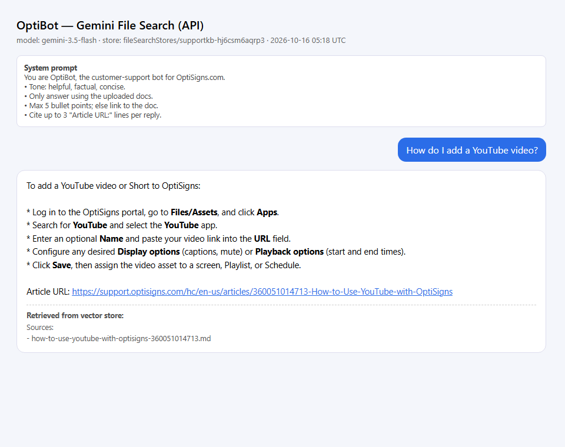

# kbx-delta-ingest

Scrapes a Zendesk help center -> clean Markdown -> **Gemini File Search** (vector store) via API, then re-runs daily and uploads only the delta.

## Setup
```bash
cp .env.sample .env          # put your GEMINI_API_KEY in .env
python -m venv .venv && . .venv/bin/activate   # Windows: .venv\Scripts\activate
pip install -r requirements.txt
```

## Run locally
```bash
python main.py                                        # scrape + delta upload, logs counts, exits 0
python main.py ask "How do I add a YouTube video?"    # query the assistant (OptiBot system prompt)
pytest -q                                             # 11 unit tests (cleaner + delta logic)

docker build -t kb-sync .
docker run --rm -e API_KEY=<gemini-key> kb-sync main.py   # runs once, exits 0
```

## How it works
- **Scrape** - Zendesk Help Center API v2 (`/api/v2/help_center/en-us/articles.json`), all published articles (413 today; `MAX_ARTICLES` to cap).
- **Clean** - BeautifulSoup strips nav/header/footer/scripts/ads/inline base64 images; markdownify emits ATX headings, fenced code blocks with language, and help-center links rewritten to **relative** paths. Each file is `data/articles/<slug>-<id>.md` and starts with `# Title` + `Article URL: ...` so every chunk's source can be cited.
- **Chunking** - whitespace-token windows of **512 tokens with 128 overlap** (512 is Gemini's max). Most articles are short how-tos (median ~1 chunk); a 512-token window keeps a full numbered procedure together, and the 25% overlap keeps step N and N+1 in the same chunk when a procedure spans a boundary. Logged as `chunks_embedded` (estimated from token count; Gemini does not return the exact chunk count).
- **Delta** - each document is uploaded with metadata `article_id` + `content_hash` (SHA-256 of the cleaned Markdown). On every run the store's documents are listed and compared: new -> upload, changed hash -> upload new then delete old, same hash -> skip, missing from help center -> delete. State lives **in the vector store itself**, so the container is stateless and safe to run anywhere.
- **Assistant** - `gemini-3.5-flash` + File Search tool with the verbatim OptiBot system prompt (falls back to lite models on 503).

## Daily job
GitHub Actions cron (`.github/workflows/daily-sync.yml`, 02:00 UTC): runs tests -> builds the Dockerfile -> runs the container -> publishes counts to the job summary and uploads `sync.log` + `last_run.json` as an artefact.

- **Job logs:** [all runs](https://github.com/musknguyen/kbx-delta-ingest/actions/workflows/daily-sync.yml) | [last run + artefact](https://github.com/musknguyen/kbx-delta-ingest/actions/runs/38855268228)
- Last run: `articles_scraped: 413 | added: 0 | updated: 0 | skipped: 413 | deleted: 0 | failed: 0`

## Screenshot
Question: *"How do I add a YouTube video?"* - answered with the cited Article URL.


